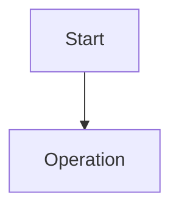

**One plan, then build, then deploy.** Planning only. No production code. Do not call CreatePlan. In Plan mode, write the markdown file directly.

The master plan is the only build input. Do not write `sub-plans/` or `test-plans/`. A second plan file is how scope drifts.

```
docs/feature/{feature}/
  references/                         # brief, process handoffs
  {feature}-master-plan.md            # the plan
  merge-requests/                     # merge-plan writes these at deploy
```

**Naming:** kebab-case `feature` from the brief. Each sub is `{step}-{repo}-{task}` with `step` zero-padded (`01`, `02`). Matrix row ids are `S{step}-{nn}` (`S01-01`).

**Input:** a brief file, an `@` reference, or pasted text. Optional one-line constraints ("new route in EdenApi.php").

**Home repo:** the repo that holds `docs/feature/<feature>/`. If the user names a directory, that repo is home. If a master plan already exists, that repo is home.

**Resume:** if `{feature}-master-plan.md` exists and `ready` is a date, do not redraft it. Tell the user to click Build. If `ready` is `pending`, continue from the first unfinished step. Do not open a second planning pass.

**Write rule:** short sentences. Name the actor, the input, and the output. Forbidden fillers: "etc", "various", "as needed", "handle appropriately".

**Evidence:** a claim marked verified cites `path:line` or a standard URL plus the section. Anything else is labelled inferred. Open the file before citing it.

A missing `.cursor/STRUCTURE.md` does not stop the run.

**Branch.** Before the first write in a repo, `git fetch origin` and read `git branch --show-current`. When the branch is `main` or `master`, stop. Do not write the plan on that branch. Create `feature/<feature>` from `origin/main`, or from `origin/master` when `main` does not exist. A PHP repo uses `origin/develop`. When the user is already on a feature branch, branch off that branch. Push only the new branch. A person merges the request into `main` or `master`.

---

## Flow

Run these in order. Do not write sub-plans before the grilling frontier is empty, or before the user accepts a written default for each blocking question. Do not ask a grilling question until the briefing in step 4 is written.

### 1. Find the repos

List every repo the brief touches, from `@` paths, workspace folders, and files named in the brief. Record the home repo.

### 2. Recon, one subagent per repo

Dispatch the subagents in parallel. Each subagent returns facts, not a plan:

- `git remote get-url origin` (the host)
- whether these exist: `.cursorrules`, `AGENTS.md`, `.cursor/STRUCTURE.md`, `.cursor/CONTEXT.md`
- every file in `.cursor/rules/`: path, `alwaysApply`, `globs`
- merge request template path: `.gitlab/merge_request_templates/default.md`, else `.github/pull_request_template.md`, else `default`
- gate commands named in `.cursorrules`, `AGENTS.md`, or `.cursor/STRUCTURE.md`. A JavaScript repo uses pnpm. Record `pnpm` commands. Do not record `npm` or `yarn`.
- blast radius for the brief keywords: shared modules, tables, routes, env var names, flags. Open the files. Do not guess paths.
- when the brief changes an API, a schema, or a generated client: that repo's regenerate commands. Open the script. Do not guess the command.

Write the **Repos** table from those reports.

### 3. Large processes

When the brief depends on a process too large to read in this thread, follow [generate-handoff-doc](../../documentation/generate-handoff-doc/SKILL.md) in process-explainer mode. Write `references/{topic}-handoff.md` in the home repo. Do not invent the process.

### 4. Brief, then grill

Write the briefing first. Follow the wait-what skill: Simplified Technical English (ASD-STE100), and the terms already in the home repo `.cursor/CONTEXT.md`. One subject per sentence. The same thing keeps the same name. No question in this message.

The briefing has:

- **Current state.** What the code does today. Each claim cites `path:line`.
- **Expected outcome.** One sentence. Actor, input, output.
- **Proposed flow.** One mermaid diagram. Node ids are camelCase with no spaces.
- **Matrix.** One row per operation. Columns: operation, when, output, side effect. This is the shape of the plan, not the final file.
- **Each open choice.** The options, what the code does today for each, and the tradeoff in one sentence. This is the research from step 2 and step 3. Do not leave an option as a name with no explanation.
- **Not verified.** What you could not find.

Stop. The user reads this before any decision.

Then follow the grilling skill and the domain-modeling skill. Ask the whole frontier in one round. Number each question and give a recommended answer. Above each question, restate the current-state fact and the options in one or two short sentences, so the question can be answered from that text alone. Wait. The user decides. Look up facts yourself. Do not ask the user for anything a file or command can answer.

When the user says they do not know, or asks you to simplify: do not repeat the question. Find the missing fact. Re-pitch that one choice in shorter sentences, with the new evidence. Ask again only after that re-pitch.

When a term is settled, write it into the home repo `.cursor/CONTEXT.md`. When a decision is an architecture choice later readers must not relitigate, write `docs/adr/` in the home repo.

Stop this step when the frontier is empty, or when the user gives a written default for every question still open. Record those defaults in **Decisions**. A blocking row with no decision means the plan is not ready. Do not leave it for Build.

### 5. Write the one plan

Create `references/` and `merge-requests/` if missing. Write `{feature}-master-plan.md` from the template below. Subs, tests, flows, and deploy steps are sections in this file.

**Sub order.** Each sub is one repo and one deployable step.

- Sub 01 deploys on its own.
- Each later sub sets `needs` to `none` or to the earlier steps that must already be deployed.
- A sub is a thin working increment, not a horizontal layer. Do not split "all schema" from "all UI" when one repo can ship a usable step.
- When a later repo cannot be safe until an earlier repo is deployed, the earlier sub stays deployable through a flag, a dormant route, or an additive change. Say which, on that sub.
- Order is the deploy order.
- Scope is the **Objectives** and the matrix rows. A behaviour in neither is out. Do not add one.

**API regenerate.** When a sub changes an API, a schema, or a generated client, that sub names the target project's regenerate commands, in order, and lists the generated files in **Files**. Find the commands in that repo during recon. Do not copy another project's script. When recon cannot find a script, add an ambiguity row. Do not invent the command.

c360 runs in this order. The hub step needs the environment steps already done:

1. In the environment directory: `./run.sh generate typescript` for the data client.
2. In the environment directory: `./run.sh push database schema`.
3. In hub: `./run.sh open api regenerate`.

**Edge case matrix.** One row per case. Columns: number, scenario, layer, expected, outcome. Cover empty input, length boundaries, auth failure, wrong owner, illegal state, race, double submit, injection, timeout, and partial failure. An unbounded set is an ambiguity row, not a summary. Each row is also a test under that sub.

**Security.** Name the controls this feature relies on. Use the OWASP ASVS chapters that apply: authentication, access control, validation, output encoding, data protection, error handling. Each control has a verified citation or an ambiguity row. Test rows carry the OWASP WSTG ids.

### 6. Fill each sub section

One subagent per sub, in parallel. Give it only that sub's outcome, the matrix rows it owns, and that repo's rules list. Do not paste the whole plan.

The subagent follows [construct-sub-plan](../construct-sub-plan/SKILL.md) and [construct-test-plan](../construct-test-plan/SKILL.md) and returns one `## Sub NN` section. The parent inserts it. No extra files. No code.

### 7. Close the plan

Check once, in this thread:

- every ambiguity is a **Decisions** row
- every matrix row has an output and a side effect
- every edge-case row has a test row under its sub
- deploy for each sub matches the file checks in [the pull request template](../vertically-slice-changes/references/pull_request_template.md)

A failed check is fixed here. A new blocking choice goes back to step 4. Do not start Build with it open.

Set **Approvals** `ready` to today's date. Tell the user the plan path and to click Build. Do not ask them to run another planning skill.

---

## Master plan template

~~~~md
# {Feature Title}

| Slug | Value |
|------|-------|
| feature | {feature} |
| home | {repo} |
| artefact_dir | docs/feature/{feature}/ |

## Repos

| repo | root | host | mr_template | gates | rules |
|------|------|------|-------------|-------|-------|
| eden | /abs/path | git host | .gitlab/merge_request_templates/default.md | command; command | .cursorrules; AGENTS.md; .cursor/rules/api.mdc |

## Context

## Objectives

## Scope

### In scope

### Out of scope

## Impact & Blast Radius

## Research Notes

| claim | evidence | kind |
|-------|----------|------|
| | path:line or URL#section | verified or inferred |

## Decisions

## Sub 01 — {repo} — {task}

Outcome: {actor, input, output}.
Needs: none.
Deploys alone: {flag, dormant route, or additive}.

### Files

| Action | Path | Notes |
|--------|------|-------|
| change | | |

### Scaffold

### Matrix

| id | status | operation | when | output | side effect | repo source |
|----|--------|-----------|------|--------|-------------|-------------|
| S01-01 | planned | | | | | path:line or TODO |

### Flow



### Tests

| # | edge | wstg | check | expected |
|---|------|------|-------|----------|
| 1 | 1 | | automated or manual | |

### Deploy

Generate: {commands in order, or none}.
Steps from the file checks for this repo. A PHP production push is a person's step.

## Edge Cases

| # | scenario | layer | expected | outcome |
|---|----------|-------|----------|---------|
| 1 | | | | |

## Security

| control | ASVS chapter | evidence |
|---------|--------------|----------|
| | V5 validation | path:line or URL#section |

## Approvals

| Gate | Status | Note |
|------|--------|------|
| ready | pending | set when step 7 passes |

## Ambiguities

| id | where | unclear | blocks | recommendation |
|----|-------|---------|--------|----------------|
| A1 | S01-01 | | yes | A: … — …. B: … — …. |

## As built

## Deviations

| id | planned behaviour | shipped behaviour | why |
|----|-------------------|-------------------|-----|

## Sync Log
~~~~
