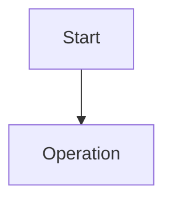

/caveman ultra

**Bind:** `.cursor/STRUCTURE.md` + `.cursor/CONTEXT.md`. Task brief + PM sign-off = truth. One repo root per run.

**SDLC:** One skill, start to finish. Do not send the user to another orchestration skill. Draft and gates write no production code. After both gates are `acknowledged`, walk one unchecked sub at a time. Implement only the active sub, and only when the user asks to build it. When the user marks that sub complete, write what the code actually did back into this master plan, then walk the next sub.

**Artefact root:** `docs/feature/<feature>/`

```
docs/feature/{feature}/
  {feature}-master-plan.md
  {feature}-delivered-feature-plan.md   # this skill writes this after ready-for-deployment ack
  sub-plans/
    {step}-{task}-sub-plan.md
  test-plans/
    {step}-{task}-test-plan.md
```

**Naming:** derive kebab-case `feature` (product area) from brief. Each sub row gets zero-padded `step` (`01`, `02`, …) + `task` slug (subtask scope). Write slugs in plan header — sub/test skills reuse them. Matrix row ids are `P{phase}-{nn}` (`P01-01`).

**Input:** user brief, or an existing `{feature}-master-plan.md` plus "sub {step} complete" / "phase {nn} complete" / "next". Human may paste prior ChatGPT output from `docs/task-refinement-prompt.md` — read only; do not invoke external skills.

**Resume:** if the master plan file already exists, do not redraft from scratch. Read it. The active sub is the first unchecked row under Deliverable Phases.

**Write rule:** short sentences. Name the actor, the input, and the output. No essay paragraphs in matrix or flow sections. Forbidden fillers: "etc", "various", "as needed", "handle appropriately".

---

## Planning methodology (run in order before the artefact is final)

Work through these three planning passes in the chat and in Research Notes. Do not skip ahead to sub-plans until the master draft exists and both approval gates are satisfied.

### Pass A — Top-level impact analysis

- Evaluate the full task brief against the current repo (`git status`, `git diff`, grep brief keywords).
- Read neighbour files per STRUCTURE patterns. Open files you cite — do not guess paths.
- Map **blast radius**: shared modules, DB tables, API routes, env vars, feature flags, cross-app contracts.
- List **architectural conflicts** with existing patterns (naming, layering, auth, data flow).
- Note **migration / rollout** risks and backwards-compat constraints.
- Record who to ask for each open technical question (**role**, not person).
- Output lands in **Impact & Blast Radius** and **Research Notes** (files read, grep hits, inferred vs verified).

### Pass B — Requirement analysis

- Extract **objectives** from the brief — verbatim where possible.
- **Scope in** and **scope out** — explicit bullets. If the brief is silent, state the default and add an ambiguity row.
- Pull **acceptance hints** and **constraints** (performance, compliance, tenancy, deadlines).
- Break work into **logical subtasks**. Order by execution priority and dependencies.
- Use Pass A findings so ordering does not hide breaking changes behind later steps.
- Group subtasks into **deliverable phases** (shippable slices). Each phase gets one outcome sentence.
- Output lands in **Objectives**, **Scope**, **Deliverable Phases** (checkbox rows), and **Gaps** when you have evidence.

### Pass C — System design

- **Technical limits** and platform constraints (runtime, quotas, third-party APIs).
- **Input/output matrix** — one row per input combination per phase (see below). Unbounded sets become ambiguity rows, not summaries.
- **Process flows** — current vs proposed per phase; every matrix operation is a node.
- **Edge-case categories** per phase (auth fail, null/empty, timeout, race, double-submit, abuse, back-nav, partial failure) — categories only; per-sub test specs come when walking that sub.
- **Test strategy:** existing tests that must still pass (file + test name); new tests by name per phase; map **unit / integration / manual** areas in **Test Categories**.
- Apply **/ponytail** posture: smallest correct diff, no speculative layers, one concern per change, match neighbour code style.
- List **ambiguities** at the bottom with 2–3 options and tradeoffs each. Do not choose for the user.

---

## Work steps (map to the master plan file)

### 1. Repo recon

Same as Pass A. Every claim in the plan that says "verified" must trace to an opened file or command output in Research Notes.

### 2. Req extract

Same as Pass B objectives, scope, acceptance, constraints.

### 3. Deliverable phases

- Each phase: outcome sentence; `Depends on: none | Phase NN`.
- **Existing tests** that must still pass — file + test name. If none: `none found` + search used.
- **New tests** this phase owns — names only until the sub is walked; then write `test-plans/{step}-{task}-test-plan.md`.
- Nest sub rows under the phase. Assign `step` (`01`…`99`) in execution order.
- Add a **phase note** when subs can run in parallel or when one sub blocks another.
- Each sub row → `sub-plans/{step}-{task}-sub-plan.md` (created when walking that sub).

### 4. Input/output matrix

- One table per phase. Columns: `id`, `status` (start as `planned`), `operation`, `when`, `output`, `side effect`, `repo source`.
- One row per **input combination**. Same operation with different inputs = different rows.
- `repo source` = path:line or `TODO` if not in repo yet.

### 5. Process flows

- Per phase: **current** and **proposed** `flowchart` (mermaid).
- Node ids: camelCase, no spaces. `TODO` node if code missing. Do not invent branches.
- Trace sync call chains to store / queue / outbound HTTP.
- Mark async boundaries and authz / validation gates on the diagram.

### 6. Gaps (when applicable)

- Table: `# | gap | evidence (path:line or behaviour observed)`.
- Use when the brief implies a problem the repo already partially solves — separate **verified gaps** from **nice-to-haves**.

### 7. Ambiguities

- Table at the bottom: `id`, `where`, `unclear`, `blocks`, `recommendation` (options A/B/C with one-line tradeoff each).
- Blocking ambiguities must be resolved at Gate B before sub-plans start.

---

## Formatting requirements (master plan file)

Write these sections **in this order**. Do not omit empty sections — use a one-line placeholder if nothing applies yet.

1. Header slugs table
2. **Context** — SQL snippets, file paths, env var **names** (no secrets)
3. **Objectives** — from brief
4. **Scope** — in / out
5. **Impact & Blast Radius** — Pass A summary
6. **Gaps** — optional; evidence-backed
7. **Research Notes** — what was read, grep hits, inferred vs verified
8. **Deliverable Phases** — phases, tests, sub checkbox rows, phase notes, **As built** per phase (filled after subs complete)
9. **Input / Output Matrix** — per phase
10. **Process Flows** — per phase, current + proposed
11. **Test Categories** — unit / integration / manual areas; detail expands in per-sub test-plans
12. **Approvals** — `matrix-flow`, `ambiguity-echo`
13. **Ambiguities**
14. **Decisions** — empty until ambiguity-echo acknowledged
15. **Sync Log** — append on each confirmed sub completion

---

## Stop gates

Write the draft with both Approvals rows `pending` and Decisions empty. Then **stop**. Do not walk a sub yet.

**Gate A — matrix-flow.** Ask the user to approve the matrix and flows, or to name the row or node that is wrong. Do not fill Decisions. Fix named rows and ask again. Set `matrix-flow` to `acknowledged` only when the user approves.

**Gate B — ambiguities.** The table already holds recommendations. The user answers each row: accept, pick another option, or defer with a written default. The agent does not choose.

**Echo-back.** Before editing the plan, restate every decision in your own words: ambiguity id, the choice, and what will change in the phase, matrix, or diagram. Wait. On refinement, restate again. On acknowledgement, set `ambiguity-echo` to `acknowledged`, write **Decisions**, and patch the affected rows so the plan matches the words just confirmed.

Prompt the human for any remaining unknowns before Gate B closes. A thread switch copies the open gate, active sub, and next action into the chat. It does not close an unanswered ambiguity and it does not start the next sub.

---

## Phase loop

Both Approvals rows `acknowledged`. Then stay in this skill.

**Walk the active sub.** In the chat, cover only the first unchecked row:

- phase outcome and matrix row ids this sub implements
- proposed flow nodes this sub touches
- explicit **out of scope** for this sub
- files to add/change, APIs, data shapes (scaffold-level)
- tests to write (`describe` / `it` intent) and manual smoke bullets
- STRUCTURE **Gates** for done (`pnpm lint`, `pnpm ts-check`, tests per STRUCTURE)
- done when the user says this sub is complete

Write or refresh `sub-plans/{step}-{task}-sub-plan.md` using the sub-plan shape below. Write `test-plans/{step}-{task}-test-plan.md` if missing (edge cases, automated spec table, manual checklist). Do not copy the full matrix into the sub-plan. Stop. Do not start the next sub in the same turn.

**On "sub {step} complete" or "phase {nn} complete":**

1. Read `git diff` and run Gates / tests named on that phase. Do not trust the plan text over the diff.
2. Restate what shipped in your own words: files, output, side effect, deviations from matrix rows. Wait. On correction, restate again.
3. After user confirms, patch the master plan: check off sub row; fill **As built** on the phase; update matrix row `status` and shipped columns; append **Sync Log**.
4. If another sub is unchecked, walk it and stop.
5. If every sub is checked, ask whether the feature is complete and ready for deployment. On yes, write `{feature}-delivered-feature-plan.md` from the diff (original matrix + diagrams kept; as-shipped matrix + third diagram per phase; deviations table; tests passed). Then draft the MR body. Master plan stays the planning record.

---

## Sub-plan file shape (when walking a sub)

~~~~md
# {Subtask Title}

| Slug | Value |
|------|-------|
| feature | {feature} |
| step | {step} |
| task | {task} |
| phase | Phase {nn} |
| matrix_rows | P01-01, ... |
| master | {feature}-master-plan.md |
| test_plan | test-plans/{step}-{task}-test-plan.md |

## Goal

## Out of scope

## Steps

## Files
| Action | Path | Notes |

## Scaffold

## Tests to Write
| File | describe/it | Assertion intent |

## Done Criteria

## Ambiguities

## Build
- Mode: Cursor Build (Agent)
- Skills: /caveman ultra + /ponytail
- Input: this sub-plan only; no scope creep vs master-plan
~~~~

---

## Master plan output template

Create dirs `sub-plans/` + `test-plans/` if missing. Write `{feature}-master-plan.md`:

~~~~md
# {Feature Title}

| Slug | Value |
|------|-------|
| feature | {feature} |
| artefact_dir | docs/feature/{feature}/ |
| sub_plans_dir | sub-plans/ |
| test_plans_dir | test-plans/ |
| delivered | {feature}-delivered-feature-plan.md |

## Context

## Objectives

## Scope

### In scope

### Out of scope

## Impact & Blast Radius

## Gaps

| # | gap | evidence |
|---|-----|----------|

## Research Notes

## Deliverable Phases

### Phase 01 — {name}

Outcome: {actor, input, output — one sentence}.
Depends on: none | Phase NN.

Existing tests that must still pass:

| File | Test name |
|------|-----------|

New tests this phase owns (names only until sub is walked):

- {test name}

- [ ] 01 — {task-slug} — {one-line description} → `sub-plans/01-{task-slug}-sub-plan.md`

**Phase note:** {parallel OK | blocks Phase NN | subs 01–02 parallel; 03 needs 01+02}

#### As built

## Input / Output Matrix

### Phase 01

| id | status | operation | when | output | side effect | repo source |
|----|--------|-----------|------|--------|-------------|-------------|
| P01-01 | planned | | | | | |

## Process Flows

### Phase 01 — current



### Phase 01 — proposed


## Test Categories

| Area | What to cover | Detail in |
|------|---------------|-----------|
| unit | | test-plans per sub |
| integration | | test-plans per sub |
| manual | | test-plans per sub |

## Approvals

| Gate | Status | Note |
|------|--------|------|
| matrix-flow | pending | |
| ambiguity-echo | pending | |

## Ambiguities

| id | where | unclear | blocks | recommendation |
|----|-------|---------|--------|----------------|
| A1 | P01-01 | | yes | A: … — …. B: … — …. |

## Decisions

## Sync Log

### {date} — {step}-{task}
- shipped:
- matrix:
- gates:
- deviations:
~~~~
