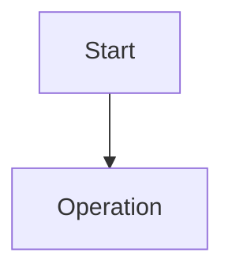

/caveman ultra

**Bind:** `.cursor/STRUCTURE.md` + `.cursor/CONTEXT.md`. Task brief + PM sign-off = truth. One repo root per run.

**SDLC:** One skill, start to finish. Do not send the user to another orchestration skill. Draft and gates write no code. After both gates are `acknowledged`, walk one unchecked sub at a time. Implement only the active sub, and only when the user asks to build it. When the user marks that sub complete, write what the code actually did back into this master plan, then walk the next sub.

**Artefact root:** `docs/feature/<feature>/`

```
docs/feature/{feature}/
  {feature}-master-plan.md
  {feature}-delivered-feature-plan.md   # this skill writes this after ready-for-deployment ack
  sub-plans/
    {step}-{task}-sub-plan.md
  test-plans/
    {step}-{task}-test-plan.md
```

**Naming:** derive kebab-case `feature` (product area) from brief. Each sub row gets zero-padded `step` (`01`, `02`, …) + `task` slug (subtask scope). Write slugs in plan header — sub/test skills reuse them. Matrix row ids are `{phase}-{nn}` (`P01-01`).

**Input:** user brief, or an existing `{feature}-master-plan.md` plus "sub {step} complete" / "phase {nn} complete" / "next". Human may paste prior ChatGPT output from `docs/task-refinement-prompt.md` — read only; do not invoke external skills.

**Resume:** if the master plan file already exists, do not redraft it. Read it. The active sub is the first unchecked row under Deliverable Phases.

**Write rule:** short sentences. Name the actor, the input, and the output. No essay paragraphs in phases, matrix, or flows. Forbidden fillers: "etc", "various", "as needed", "handle appropriately".

---

## Phases

### 1. Repo recon
- `git status` + `git diff` — what already changed
- grep brief keywords — where code lives
- read neighbour files per STRUCTURE patterns
- map blast radius, shared deps, arch conflicts
- search existing tests the change can break (file + test name)

### 2. Req extract
- objectives from brief (verbatim where possible)
- scope in / scope out
- acceptance hints, constraints

### 3. Deliverable phases
- group work into shippable phases
- each phase: one concrete outcome sentence; depends on prior phase or `none`
- existing tests that must still pass — file + test name from the repo. If none, write `none found` and the search used
- new tests this phase owns — names only. Write the full spec into `test-plans/{step}-{task}-test-plan.md` when walking that sub
- nest sub rows under the phase. Order by execution priority + deps
- assign `step` (`01`…`99`) in execution order
- each sub row → `sub-plans/{step}-{task}-sub-plan.md`

### 4. Input/output matrix
- one table per phase
- one row per input combination. Stable id `P01-01`
- columns: operation, when (exact inputs), output, side effect, repo source
- an open or unbounded set is an ambiguity row, not a summary

### 5. Process flows
- per phase, two `flowchart` diagrams: **current** system and **proposed** system
- every matrix operation is a node. Node ids camelCase, no spaces
- `TODO` node when code does not exist. Do not invent branches
- trace the sync call chain to store / queue / outbound HTTP
- mark async boundaries (webhook, worker) and authz / validation gates
- cover every branch in scope

### 6. Impact
- migration / rollout risks
- backwards compat concerns

### 7. Ambiguities
- list at the bottom. Do not choose
- each row: id, where (phase or matrix id), what is unclear, blocks?, recommendation of 2–3 options with a one-line tradeoff each

---

## Stop gates

Write the draft with both Approvals rows `pending` and Decisions empty. Then **stop**. Do not walk a sub yet.

**Gate A — matrix-flow.** Ask the user to approve the matrix and flows, or to name the row or node that is wrong. Do not fill Decisions. Fix the named rows and ask again. Set `matrix-flow` to `acknowledged` only when the user approves.

**Gate B — ambiguities.** The table already holds recommendations. The user answers each row: accept, pick another option, or defer with a written default. The agent does not choose.

**Echo-back.** Before editing the plan, restate every decision in your own words: ambiguity id, the choice, and what will change in the phase, matrix, or diagram. Wait. On refinement, restate again. On acknowledgement, set `ambiguity-echo` to `acknowledged`, write Decisions, and patch the affected rows so the plan matches the words just confirmed.

A thread switch copies the open gate, the active sub, and the next action into the chat. It does not close an unanswered ambiguity and it does not start the next sub.

---

## Phase loop

Both Approvals rows `acknowledged`. Then stay in this skill.

**Walk the active sub.** In the chat, cover only the first unchecked row:

- phase outcome and the matrix row ids this sub implements
- proposed flow nodes this sub touches
- files to add or change, data shapes, and tests that must still pass
- done when the user says this sub is complete

Write `sub-plans/{step}-{task}-sub-plan.md` for that row if it is missing. Do not copy the whole matrix into it. Stop. Do not start the next sub in the same turn.

**On "sub {step} complete" or "phase {nn} complete":**

1. Read `git diff` and the tests named on that phase. Do not trust the plan text over the diff.
2. Restate what shipped, in your own words: files, output, side effect, and any deviation from that sub's matrix rows. Wait. On a correction, restate again.
3. After the user confirms, patch the master plan:
   - check off that sub row
   - fill **As built** on its phase with the confirmed sentences and file paths
   - on each matrix row this sub touched, set status `unchanged`, `changed`, `dropped`, or `added`, and write the shipped output, side effect, and path
   - append a Sync Log entry
4. If another sub is unchecked, walk that sub the same way and stop.
5. If every sub is checked, ask whether the feature is complete and ready for deployment. On yes, write `{feature}-delivered-feature-plan.md` from the diff. Keep every original matrix row and both original diagrams, and place the as-shipped matrix and a third diagram beside them. Same id and node rules as the master. Then stop. The master plan stays the planning record.

---

## Output template

Create dirs `sub-plans/` + `test-plans/` if missing. Write file `{feature}-master-plan.md`:

~~~~md
# {Feature Title}

| Slug | Value |
|------|-------|
| feature | {feature} |
| artefact_dir | docs/feature/{feature}/ |
| sub_plans_dir | sub-plans/ |
| test_plans_dir | test-plans/ |
| delivered | {feature}-delivered-feature-plan.md |

## Context
<!-- SQL snippets, file paths, env var names — NO secrets -->

## Impact & Blast Radius
<!-- global risks, shared deps, arch conflicts -->

## Research Notes
<!-- files read, grep hits, what inferred vs verified -->

## Deliverable Phases

### Phase 01 — {name}
Outcome: {one sentence — actor, input, output}.
Depends on: none | Phase NN.

Existing tests that must still pass:

| File | Test name |
|------|-----------|
| ... | ... |

New tests this phase owns (names only; specs in the test-plan):

- {test name}

- [ ] 01 — {task-slug} — {one-line description} → `sub-plans/01-{task-slug}-sub-plan.md`

#### As built
<!-- empty until the user confirms this phase's completed subs -->

## Input / Output Matrix

### Phase 01

| id | status | operation | when | output | side effect | repo source |
|----|--------|-----------|------|--------|-------------|-------------|
| P01-01 | planned | {verb} | {exact inputs} | {exact output} | none \| {effect} | path:line |

## Process Flows

### Phase 01 — current



### Phase 01 — proposed


## Approvals

| Gate | Status | Note |
|------|--------|------|
| matrix-flow | pending | |
| ambiguity-echo | pending | |

## Ambiguities

| id | where | unclear | blocks | recommendation |
|----|-------|---------|--------|----------------|
| A1 | P01-01 | {what is unclear} | yes | A: {option} — {tradeoff}. B: {option} — {tradeoff}. |

## Decisions
<!-- empty until ambiguity-echo is acknowledged -->

## Sync Log
<!-- append one entry each time the user confirms a completed sub -->
### {date} — {step}-{task}
- shipped: {one sentence}
- matrix: {ids and status}
- deviations: none | {what the code did instead}
~~~~
