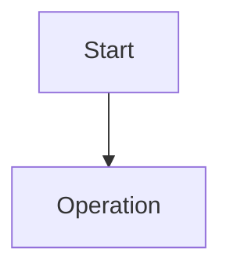

/caveman ultra

**Bind:** `.cursor/STRUCTURE.md` + `.cursor/CONTEXT.md`.

**SDLC:** Deployment / merge request. All subs checked off in master. Gates green.

**Input:**
- reconciled `{feature}-master-plan.md`
- completed sub-plans
- all `test-plans/{step}-{task}-test-plan.md` tick summaries
- green STRUCTURE **Gates**
- git diff (final)

Do not write the MR or the delivered file until the user acknowledges the feature as complete and ready for deployment.

---

## Phases

### 1. Read truth
- master plan = source for Summary + Architecture, and for the original phases, matrix, diagrams, and decisions
- aggregate Pass Criteria + ticked rows from all test-plans = Verification Proof
- diff + completed sub-plans = what the code actually does

### 2. Ready gate
- ask the user to acknowledge the feature as complete and ready for deployment
- stop until they do. Do not infer acknowledgement from green Gates

### 3. Delivered feature plan
- write `docs/feature/{feature}/{feature}-delivered-feature-plan.md` from the diff, completed sub-plans, and ticked test-plans
- master plan stays the planning record. Do not replace it with the shipped record
- keep the same phase ids, matrix row ids, and diagram node ids
- carry every original matrix row. Do not summarise combinations the master listed
- for each phase, matrix, and diagram show **Original** (copied from the master) and **As shipped** (rewritten from the code)
- matrix status per row: `unchanged` | `changed` | `dropped` | `added`
- changed and added rows state the output and side effect the code produces, with the file path
- dropped rows say what was not built
- third mermaid per phase, **as shipped**, traced from the code. Node ids camelCase, no spaces. `TODO` only where the operation is still missing. Do not invent branches
- Deviations table: row id, original behaviour, shipped behaviour, why
- tests that passed: file + test name + gate result

### 4. Cleanup note
- list abandoned `sub-plans/{step}-{task}-sub-plan.md` files removed
- list obsolete `test-plans/{step}-{task}-test-plan.md` files removed
- incomplete plans deleted from artefact dir

### 5. Write MR body
- raw markdown — paste to Git platform
- Plan Artefacts lists the delivered file

---

## Delivered file template

~~~~md
# {Feature Title} — delivered

| Slug | Value |
|------|-------|
| feature | {feature} |
| master | {feature}-master-plan.md |
| acknowledged | {date} — ready for deployment |

## What shipped
{short sentences from the diff: actor, input, output}

## Deliverable Phases

### Phase 01 — {name}

#### Original
Outcome: {copied from master}.
Depends on: none | Phase NN.

#### As shipped
Outcome: {what the code does}.
Depends on: none | Phase NN.

Tests that passed:

| File | Test name | Gate result |
|------|-----------|-------------|
| ... | ... | pass |

## Input / Output Matrix

### Phase 01 — original

| id | operation | when | output | side effect | repo source |
|----|-----------|------|--------|-------------|-------------|
| P01-01 | ... | ... | ... | ... | ... |

### Phase 01 — as shipped

| id | status | operation | when | output | side effect | repo source |
|----|--------|-----------|------|--------|-------------|-------------|
| P01-01 | unchanged \| changed \| dropped \| added | ... | ... | ... | ... | path:line |

## Process Flows

### Phase 01 — original current



### Phase 01 — original proposed


### Phase 01 — as shipped


## Decisions kept
<!-- copied from master Decisions -->

## Deviations

| id | original behaviour | shipped behaviour | why |
|----|--------------------|-------------------|-----|
| P01-01 | ... | ... | ... |
~~~~

---

## MR template

```md
## Summary
<!-- 2-3 sentences from master Context + what shipped -->

## Architectural Changes
<!-- bullets: structural updates, DB, API — from delivered file + diff -->

## Verification Proof
<!-- from all test-plans: automated pass, manual ticks, gates run -->

## Maintenance
<!-- Sentry, Vercel, DB CPU, alerts — from master Impact -->

## Plan Artefacts
- master: docs/feature/{feature}/{feature}-master-plan.md
- delivered: docs/feature/{feature}/{feature}-delivered-feature-plan.md
- sub-plans: docs/feature/{feature}/sub-plans/
- test-plans: docs/feature/{feature}/test-plans/
- abandoned plans removed: ...
```

Post-merge: master plan and delivered feature plan live in the MR overview per SDLC Maintenance phase.
